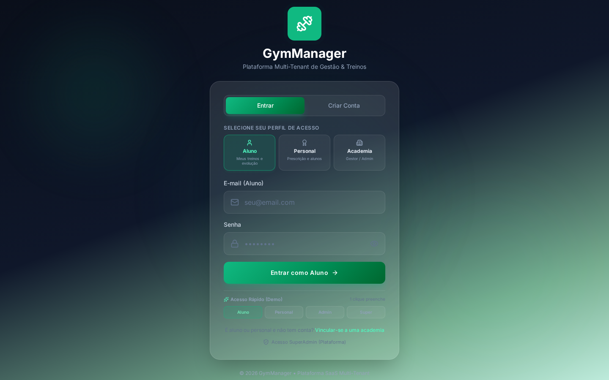

<p align="center">
  
</p>

<h1 align="center">GymManager</h1>

<p align="center">
  Sistema completo de gestão para academias — gerencie alunos, treinos, exercícios e evolução física em um único lugar.
</p>

<p align="center">
  
  
  
  
  
  
</p>


---

## 📋 Sobre o Projeto

**GymManager** é uma aplicação web progressiva (PWA) desenvolvida em React + TypeScript para gestão de academias. O sistema opera 100% no navegador utilizando **localStorage** como banco de dados, sem necessidade de backend ou servidor.

## 👥 Equipe de Desenvolvimento
| Responsável	| GitHub
| --- | --- |
| Anderson Chrispim da Silva	| @ChrispimSilva
| Israel Felipe Chaves da Silva	| @Raelmat
| Kayque Pardim dos Santos	| @kayque-pardim
| Marcus Vinícius Campos Machado	| @marcusmachado91
| Nathan de Sales Messias	| @NathanosPregui
| Robson Silva de Pinho	| @RobSlva
| Fernanda Macedo Klein | @Fernanda9209 |


### Funcionalidades Principais

| Funcionalidade | Descrição |
|---|---|
| 🔐 **Autenticação Multi-Tenant** | Login segmentado por perfil (SuperAdmin, Admin/Academia, Personal, Aluno) e isolamento por Tenant |
| 🏢 **Gestão de Academias & Assentos** | Painel SuperAdmin para administrar academias (Tenants), contas Admin e ocupação de assentos (Seats) |
| 👥 **Gestão de Equipe & Alunos** | Cadastro de Personais e Alunos com controle de assentos ativos, medidas corporais e status |
| 🏋️ **Montagem de Treinos** | Criação de fichas de treino vinculadas a alunos com séries, repetições e carga |
| 💪 **Catálogo de Exercícios** | +200 exercícios com GIFs animados, filtro por grupo muscular e equipamento |
| 📊 **Evolução Física** | Acompanhamento de peso, % gordura, massa muscular e IMC com gráficos |
| 📱 **PWA** | Instalável no celular/desktop, funciona offline |
| 🌙 **Tema Escuro/Claro** | Alternância de tema com persistência |
| 📜 **Histórico de Atividades** | Log de ações realizadas no sistema |

### Perfis de Acesso (Multi-Tenant)

| Perfil | Escopo | Permissões |
|---|---|---|
| **SuperAdmin** | Plataforma (SaaS) | Dono da plataforma; gerencia Academias (Tenants), usuários Admin e limites/uso de assentos |
| **Admin** | Tenant (Academia) | Dono da academia; gerencia Personais, Alunos, treinos, aparelhos, identidade visual e assentos do tenant |
| **Personal** | Tenant (Academia) | Funcionário da academia; gerencia treinos, alunos, aparelhos, exercícios e evolução no seu tenant |
| **Aluno** | Tenant (Academia) | Visualiza e executa seus treinos, consulta exercícios, evolução pessoal e histórico no seu tenant |

---
<h1><a href="https://youtu.be/SOKWffpj9ko">Demonstração</a></h1>
## 🛠️ Stack Tecnológica

- **[React 19](https://react.dev/)** — Biblioteca de UI
- **[TypeScript 6](https://www.typescriptlang.org/)** — Tipagem estática
- **[Vite 8](https://vite.dev/)** — Build tool e dev server
- **[Tailwind CSS 4](https://tailwindcss.com/)** — Framework CSS utilitário
- **[React Router 7](https://reactrouter.com/)** — Roteamento SPA
- **[Chart.js](https://www.chartjs.org/) + [react-chartjs-2](https://react-chartjs-2.js.org/)** — Gráficos de evolução
- **[Lucide React](https://lucide.dev/)** — Ícones SVG
- **[Vite PWA Plugin](https://vite-pwa-org.netlify.app/)** — Suporte a Progressive Web App

---

## 🚀 Como Executar Localmente

### Pré-requisitos

- **[Node.js](https://nodejs.org/)** ≥ 18
- **npm** (incluso no Node.js) ou **yarn** / **pnpm**

### Instalação

```bash
# 1. Clone o repositório
# Via HTTPS
git clone https://github.com/ChrispimSilva/gymmanager.git
# Ou via SSH
git clone git@github.com:ChrispimSilva/gymmanager.git

# 2. Entre na pasta do projeto
cd gymmanager

# 3. Instale as dependências
npm install

# 4. Inicie o servidor de desenvolvimento
npm run dev
```

O servidor será iniciado em **http://localhost:5173** e ficará acessível também na rede local.

### Outros Comandos

| Comando | Descrição |
|---|---|
| `npm run dev` | Inicia o servidor de desenvolvimento com HMR |
| `npm run build` | Compila o TypeScript e gera o build de produção na pasta `dist/` |
| `npm run preview` | Pré-visualiza o build de produção localmente |
| `npm run lint` | Executa o ESLint para análise estática do código |

---

## 🔑 Usuários Padrão (Demo)

O sistema inclui dados de exemplo pré-carregados via `localStorage`. Na primeira execução, quatro usuários ficam disponíveis:

| Perfil | E-mail | Senha | Escopo |
|---|---|---|---|
| SuperAdmin | `superadmin@gym.com` | `super123` | Dono da Plataforma (Gerencia Academias / Admins) |
| Admin | `admin@gym.com` | `admin123` | Dono da Academia (`tenant-default`) |
| Personal | `personal@gym.com` | `personal123` | Personal da Academia (`tenant-default`) |
| Aluno | `aluno@gym.com` | `aluno123` | Aluno da Academia (`tenant-default`) |

> **Nota:** Todos os dados são armazenados no `localStorage` do navegador. Limpar os dados do navegador restaurará o estado inicial da aplicação.

---

## 📁 Estrutura do Projeto

```
gymmanager/
├── public/                  # Arquivos estáticos (favicon, ícones PWA)
├── src/
│   ├── assets/              # Imagens e SVGs da aplicação
│   ├── components/
│   │   └── layout/          # Header, Sidebar, MobileNav, MainLayout
│   ├── contexts/            # AuthContext, ThemeContext (React Context API)
│   ├── data/                # Catálogo de exercícios (exercises.json)
│   ├── hooks/               # Custom hooks (useExercises)
│   ├── pages/               # Páginas da aplicação
│   │   ├── LoginPage.tsx    # Tela de login e cadastro
│   │   ├── DashboardPage.tsx
│   │   ├── StudentsPage.tsx
│   │   ├── WorkoutsPage.tsx
│   │   ├── MyWorkoutsPage.tsx
│   │   ├── ExercisesPage.tsx
│   │   ├── ProgressPage.tsx
│   │   └── HistoryPage.tsx
│   ├── services/            # Camada de serviços (CRUD via localStorage)
│   │   ├── userService.ts
│   │   ├── studentService.ts
│   │   ├── workoutService.ts
│   │   ├── progressService.ts
│   │   └── activityService.ts
│   ├── types/               # Definições de tipos TypeScript
│   ├── utils/               # Dados iniciais (seed)
│   ├── App.tsx              # Rotas e providers
│   ├── main.tsx             # Entry point
│   └── index.css            # Estilos globais
├── index.html               # HTML template
├── vite.config.ts           # Configuração do Vite + PWA
├── tsconfig.json            # Configuração do TypeScript
├── eslint.config.js         # Configuração do ESLint
├── package.json
└── .gitignore
```

---

## 🏗️ Arquitetura e Documentação Técnica

Para entender a fundo como o projeto funciona e conferir o plano de testes, consulte os documentos:

- 📖 **[docs/ARCHITECTURE.md](docs/ARCHITECTURE.md)** — Arquitetura técnica, diagramas de entidades, fluxo de autenticação e guia de migração.
- 📋 **[docs/QA.md](docs/QA.md)** — Manual de QA, instruções para subir a aplicação localmente e matriz de cenários de teste funcionais e de regressão.
- 🧭 **[docs/USER_JOURNEYS.md](docs/USER_JOURNEYS.md)** — Documentação visual das jornadas de usuário por perfil (`SuperAdmin`, `Admin`, `Personal` e `Aluno`) com capturas via Playwright.

> **Nota:** Este projeto usa `localStorage` através do Repository Pattern com interfaces desacopladas (ideal para estudo, prototipação e PWA offline). Consulte o guia de migração na documentação para evoluir para um backend real.

---

## 🤝 Contribuindo

Contribuições são bem-vindas! Para contribuir:

1. Faça um **fork** do projeto
2. Crie uma **branch** para sua feature (`git checkout -b feature/nova-feature`)
3. Faça o **commit** das suas alterações (`git commit -m 'feat: adiciona nova feature'`)
4. Faça o **push** para a branch (`git push origin feature/nova-feature`)
5. Abra um **Pull Request**

---

## 📄 Licença

Distribuído sob a licença MIT. Veja o arquivo `LICENSE` para mais informações.

---

<p align="center">
  Feito com 💚 para a comunidade fitness
</p>
