# 🧭 Documentação das Jornadas de Usuário — GymManager

Este documento apresenta o mapeamento completo das **jornadas de usuário** do **GymManager**, ilustrando passo a passo os fluxos de cada perfil de acesso com capturas reais geradas automaticamente via **Playwright**.

---

## 📋 Visão Geral & Arquitetura Multi-Tenant

O **GymManager** é uma aplicação web progressiva (**PWA**) construída em React 19 + TypeScript + Vite que opera inteiramente no navegador utilizando **`localStorage`** através do *Repository Pattern*.

- **Isolamento por Academia (`Tenant`)**: Usuários (`admin`, `personal` e `aluno`), alunos, treinos, aparelhos, medições físicas, sessões concluídas, exercícios personalizados e registros de atividade são vinculados ao respectivo `tenantId`.
- **Licenciamento por Assento (`per_seat`)**: Cada **Personal ativo** e cada **Aluno ativo** dentro de um tenant ocupa **1 assento** no limite configurado para a academia (`maxSeats`, padrão `50` no tenant de demonstração; `null` = ilimitado). Atualmente a plataforma opera em fase gratuita (`billingStatus: 'free'`).
- **Dados de Demonstração Automáticos (`seedData`)**: Na primeira abertura da aplicação, o sistema popula o `localStorage` com a academia padrão (`GymManager Academia`, slug `iron-force`), 4 contas de acesso, 5 alunos (4 ativos e 1 inativo), 4 fichas de treino, 5 aparelhos, medições de evolução física ao longo de 6 meses e histórico de atividades.

---

## 🔑 Credenciais de Demonstração & Matriz de Acesso

### Contas Padrão (Seed)

| Perfil | E-mail | Senha | Escopo | Observações |
|---|---|---|---|---|
| **SuperAdmin** | `superadmin@gym.com` | `super123` | Plataforma SaaS | Acesso via link *"Acesso SuperAdmin (Plataforma)"* na tela de login |
| **Admin (Academia)** | `admin@gym.com` | `admin123` | `tenant-default` | Gestor da `GymManager Academia` (`Carlos Admin`) |
| **Personal** | `personal@gym.com` | `personal123` | `tenant-default` | `Prof. Rafael` (também aceita alias legado `instrutor@gym.com` / `instrutor123`) |
| **Aluno** | `aluno@gym.com` | `aluno123` | `tenant-default` | Vinculada à ficha da aluna `Ana Silva` |

### Matriz de Permissões por Rota e Ação

| Rota / Recurso | SuperAdmin | Admin | Personal | Aluno |
|---|:---:|:---:|:---:|:---:|
| `/login` (Entrar / Criar Conta) | ✅ | ✅ | ✅ | ✅ |
| `/dashboard` | ✅ *(Central SaaS)* | ✅ *(+ Assentos)* | ✅ *(Operacional)* | ✅ *(+ Iniciar Treino)* |
| `/academias` *(Academias / Tenants)* | ✅ | ❌ | ❌ | ❌ |
| `/personais` *(Equipe)* | ❌ | ✅ | ❌ | ❌ |
| `/alunos` | ❌ | ✅ | ✅ | ❌ |
| `/treinos` *(Gestão e Prescrição)* | ❌ | ✅ *(sem executar)* | ✅ *(+ iniciar/testar)* | ❌ |
| `/meus-treinos` *(Ficha + Comunidade)* | ❌ | ❌ | ❌ | ✅ |
| `/treino-ativo/:workoutId` | ❌ | ❌ | ✅ | ✅ |
| `/aparelhos` | ❌ | ✅ | ✅ | ❌ |
| `/exercicios` *(Catálogo)* | ❌ | ✅ *(+ Custom)* | ✅ *(+ Custom)* | ✅ *(somente leitura)* |
| `/evolucao` | ❌ | ✅ *(todos alunos)* | ✅ *(todos alunos)* | ✅ *(própria)* |
| `/historico` | ❌ | ✅ *(todos alunos)* | ✅ *(todos alunos)* | ✅ *(próprio)* |
| `/configuracoes` *(Identidade Visual)* | ❌ | ✅ | ❌ | ❌ |
| **Header: Meu Perfil & Avatar** | ✅ | ✅ | ✅ | ✅ |
| **Header: Tema Claro / Escuro & Notificações** | ✅ | ✅ | ✅ | ✅ |
| **Header: Backup & Gestão de Dados (AES-256)** | ✅ | ❌ | ❌ | ❌ |

---

## 🎥 Vídeo de Demonstração (Formato Mobile PWA)

Além das capturas estáticas abaixo, o fluxo completo das 5 jornadas em formato smartphone vertical (`390x844`, proporção `9:16`) está disponível no vídeo gravado automaticamente via Playwright:

- ▶️ **[docs/videos/demo-jornadas-mobile.webm](videos/demo-jornadas-mobile.webm)** — Demonstração contínua cobrindo:
  1. **Autenticação & Autocadastro:** seleção de perfil, validação cruzada, Portal SuperAdmin e formulário de vínculo à academia.
  2. **SuperAdmin (SaaS):** indicadores globais, cadastro de novo tenant (`Iron Force VIP`) e backup criptografado (`AES-256-GCM`).
  3. **Admin da Academia:** widget de assentos, gestão de personais, ficha de alunos, identidade visual e alternância para modo escuro.
  4. **Personal Trainer:** criação e prescrição de treinos em lote, aparelhos, catálogo/filtros de exercícios, evolução (`Chart.js`) e auditoria.
  5. **Aluno Mobile PWA:** ficha de treino, execução ao vivo com cronômetro e `RestTimerOverlay`, geração de card `9:16` para Instagram Stories, histórico de sessões, evolução pessoal e troca de avatar.

---

## 🗺️ Fluxo Geral de Jornadas

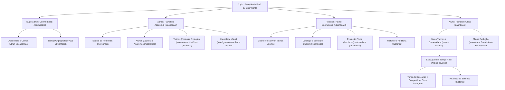

---

## 🔐 Jornada 0 — Autenticação, Seleção de Perfil & Autocadastro

**Objetivo:** Permitir que cada usuário entre no escopo correto da plataforma (`Aluno`, `Personal`, `Academia` ou `SuperAdmin`), oferecendo validação didática de perfil, preenchimento rápido para demonstração e autocadastro vinculado a uma academia ativa.

### 1. Tela Inicial de Login e Seletor de Perfis
A rota `/login` apresenta os três perfis da academia (`Aluno`, `Personal`, `Academia`), botões de **Acesso Rápido (Demo)** que preenchem e-mail e senha com um clique, o botão **"Vincular-se a uma academia"** para autocadastro e o link discreto **"Acesso SuperAdmin (Plataforma)"**.

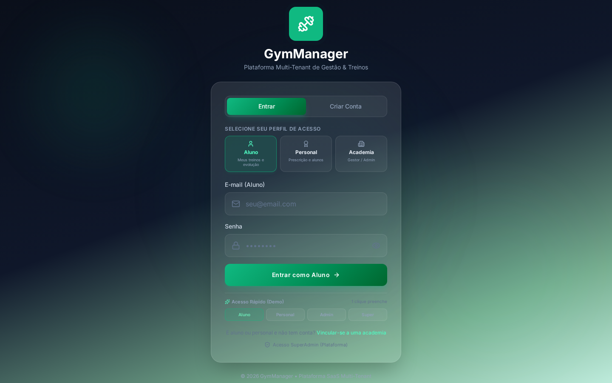

### 2. Validação Cruzada de Perfil com Troca Assistida
Ao tentar autenticar uma conta válida com o cartão de perfil errado selecionado (por exemplo, `admin@gym.com` com o perfil `Aluno` marcado), o sistema bloqueia o acesso, informa o perfil real da conta e exibe um botão de atalho **"Alternar para o perfil Academia (Admin) →"**.

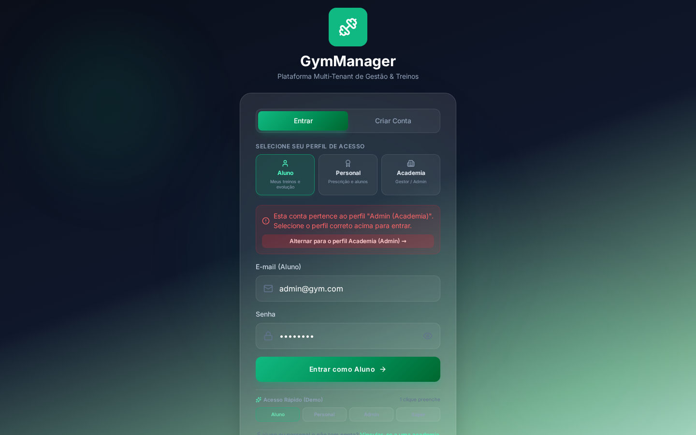

### 3. Portal SuperAdmin
Ao clicar em **Acesso SuperAdmin (Plataforma)**, o seletor de perfis da academia é substituído pelo banner dourado **Portal SuperAdmin**, restringindo a autenticação ao dono da plataforma SaaS.

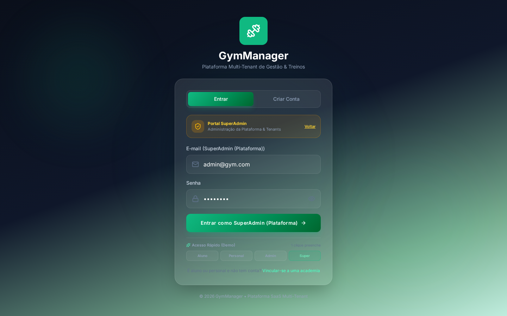

### 4. Autocadastro Vinculado a Tenant (`Criar Conta`)
Na aba **Criar Conta**, alunos e personais podem se registrar diretamente vinculando-se a uma academia ativa (`Tenant`). Quando **Sou Personal** é selecionado, o formulário exibe os campos opcionais de **CREF** e **Especialidade**; para alunos, cria automaticamente o registro na tabela de alunos e valida a disponibilidade de assentos da academia.

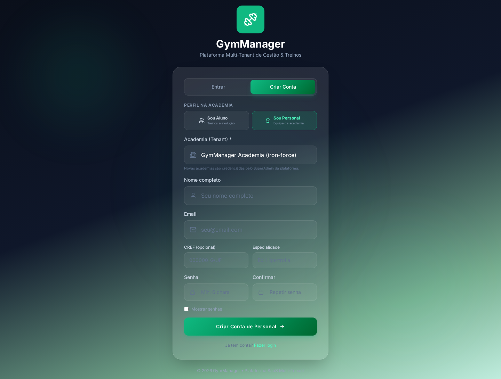

---

## 🛡️ Jornada 1 — SuperAdmin (Plataforma SaaS)

**Perfil:** `superadmin@gym.com` / `super123`  
**Objetivo:** Administrar todas as academias credenciadas (*Tenants*), provisionar contas de administradores, controlar limites de assentos (*seats*), suspender/reativar academias e gerenciar backups criptografados do sistema.

### 1. Central SaaS Multi-Tenant (`/dashboard`)
Logo após o login, o SuperAdmin visualiza os indicadores globais da plataforma: academias ativas, total de assentos ocupados, composição entre personais e alunos, receita mensal simulada por assento, lista resumida das academias e log recente da plataforma.

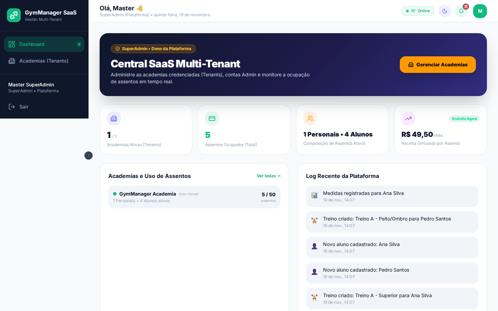

### 2. Gestão de Academias e Contas Admin (`/academias`)
A página exibe o resumo consolidado de assentos no topo, barra de busca e filtros por status (`Todas`, `Ativas`, `Suspensas`), além dos cartões detalhados de cada academia com ocupação de assentos e valor configurado por assento.

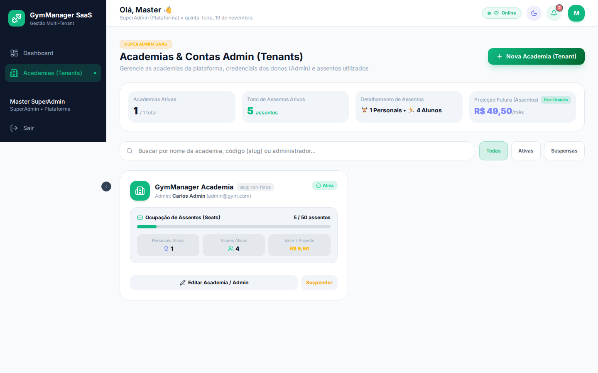

### 3. Cadastro de Nova Academia (Tenant) e Administrador
Ao clicar em **Nova Academia (Tenant)**, um modal unificado permite cadastrar os dados da academia (gerando o *slug* automaticamente a partir do nome), definir limite de assentos, valor simulado por assento, cor padrão do tema e criar imediatamente a conta do **Administrador (Dono da Academia)**.

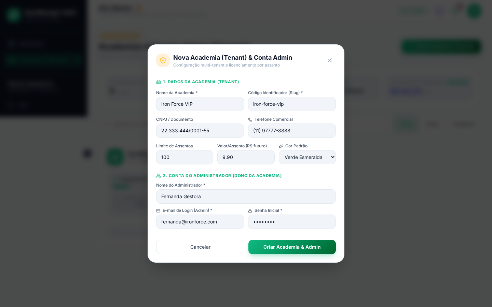

### 4. Listagem Atualizada Após Provisionamento
Após confirmar o cadastro, a nova academia (`Iron Force VIP`, slug `iron-force-vip`) aparece imediatamente na grade com seus controles de edição, suspensão/reativação e exclusão (a academia padrão `tenant-default` permanece protegida contra exclusão).

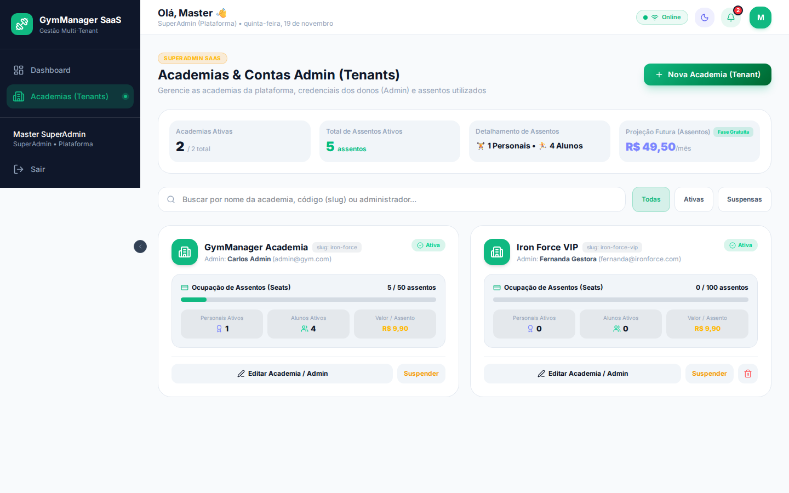

### 5. Backup & Segurança de Dados (AES-256)
Pelo menu do avatar no cabeçalho (**Backup & Gestão de Dados**), exclusivo do **SuperAdmin**, é possível realizar exportação criptografada de toda a plataforma (`.gymvault` usando **AES-256-GCM** com derivação **PBKDF2** de 100.000 iterações), restauração de arquivos `.gymvault` / `.json` e redefinição dos dados padrão de demonstração.

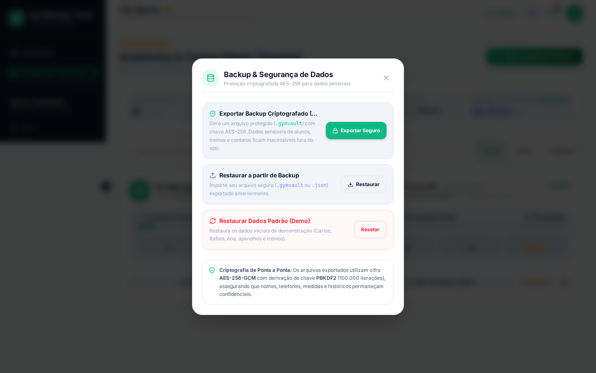

---

## 🏢 Jornada 2 — Admin (Gestor / Dono da Academia)

**Perfil:** `admin@gym.com` / `admin123`  
**Objetivo:** Gerenciar toda a operação de uma academia específica (`tenant-default`), incluindo equipe de personais, alunos, fichas de treino, aparelhos, identidade visual e acompanhamento de ocupação de assentos.

### 1. Dashboard Administrativo (`/dashboard`)
O painel do Admin apresenta o banner de boas-vindas com a identidade visual da academia, o widget dedicado de **Assentos da Academia (Tenant)** (`5 / 50`), KPIs de alunos ativos, treinos criados, sessões concluídas e taxa de retenção, além de **Ações Rápidas** e **Atividade Recente**.

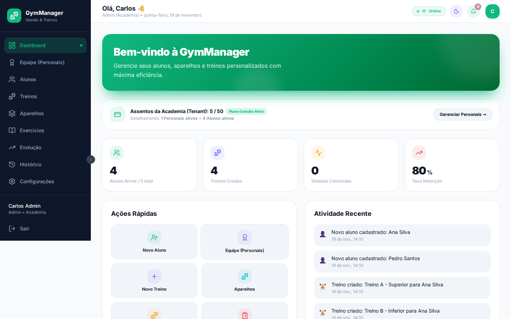

### 2. Gestão da Equipe de Personais (`/personais`)
Permite listar, buscar e filtrar os profissionais cadastrados na academia, exibindo a barra de consumo de assentos (`1 Personais ativos + 4 Alunos ativos`) e ações para editar, ativar/desativar (respeitando o limite de assentos) ou remover profissionais.

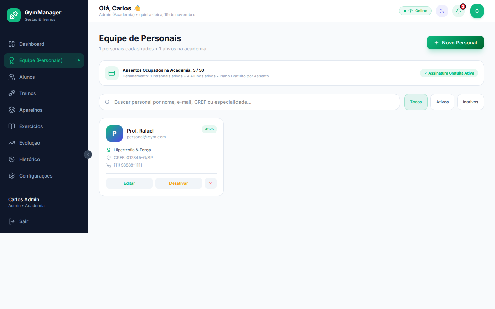

### 3. Cadastro de Novo Personal
O modal **Novo Personal da Academia** coleta nome completo, e-mail de login, telefone, registro CREF, especialidade e senha inicial, verificando se há assento disponível no tenant antes de concluir.

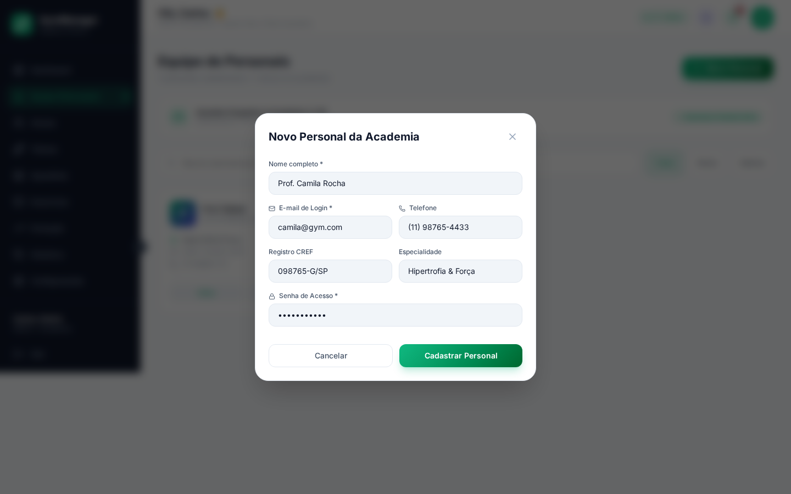

### 4. Gestão de Alunos (`/alunos`)
Exibe os alunos da academia em cards com busca por nome/e-mail/objetivo, filtro por status (`Todos`, `Ativos`, `Inativos`) e ações rápidas de edição, ativação/inativação e exclusão em cascata.

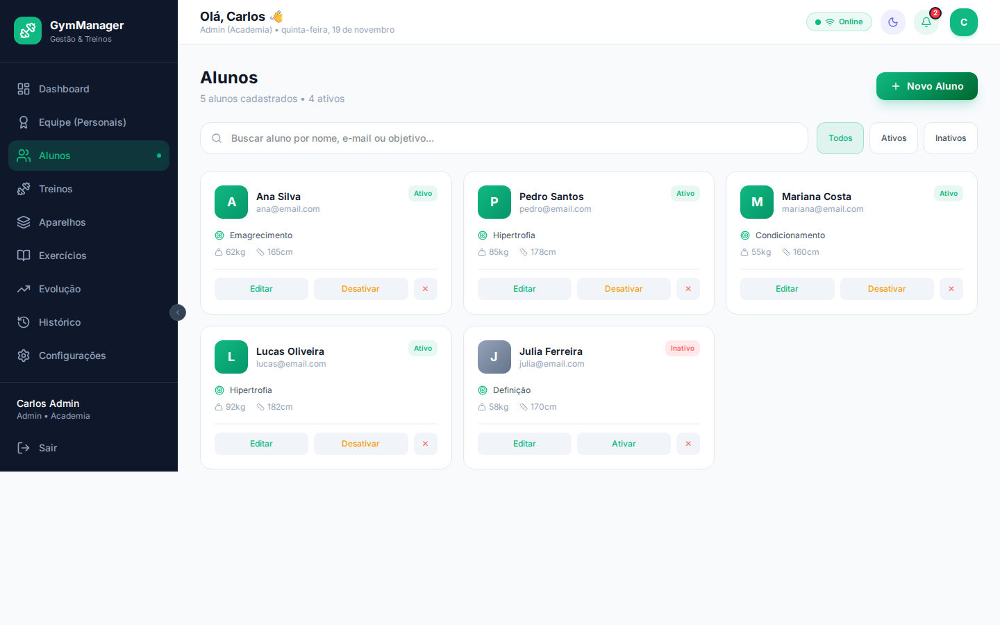

### 5. Modal de Detalhes do Aluno
Ao clicar em um card de aluno, um modal exibe a ficha resumida com status, e-mail, telefone, objetivo, peso, altura e IMC calculado automaticamente.

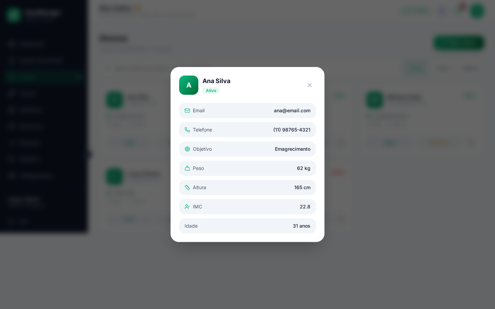

### 6. Visão Geral de Treinos (`/treinos`)
O Admin visualiza todos os treinos cadastrados no tenant (individuais ou da comunidade), podendo criar, editar, excluir, imprimir fichas em PDF ou prescrever treinos existentes para múltiplos alunos.

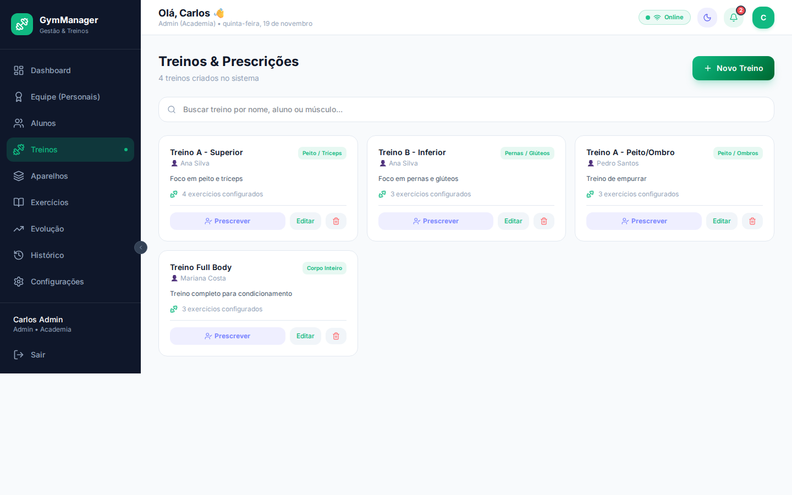

### 7. Inventário de Aparelhos & Equipamentos (`/aparelhos`)
Lista os equipamentos da academia com marca, modelo, localização livre (ex.: *Área Maromba - Piso 1*, *Setor Cardio - Andar 2*), status operacional (`Ativo`, `Manutenção`, `Inativo`), busca e filtros por local e status.

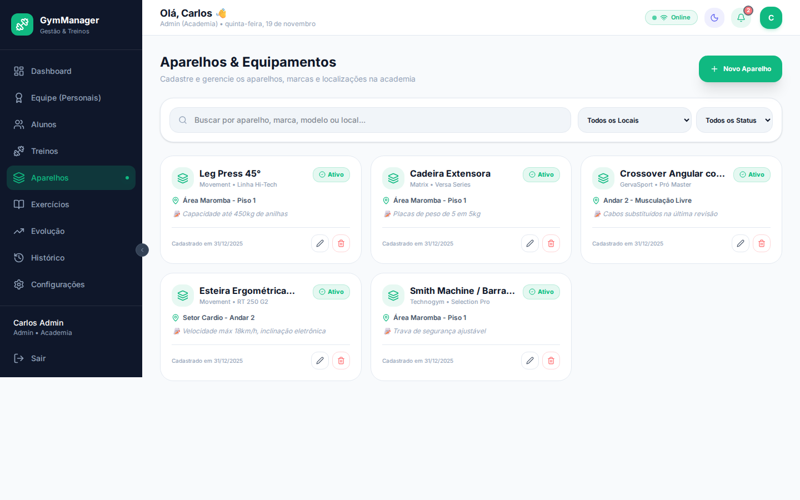

### 8. Personalização de Identidade Visual (`/configuracoes`)
Tela exclusiva do Admin para definir o **Nome da Academia**, carregar uma **logomarca** (arquivo PNG/JPG/SVG ou URL direta) e escolher entre 7 paletas predefinidas ou cor hexadecimal livre com pré-visualização instantânea em botões, badges e destaques.

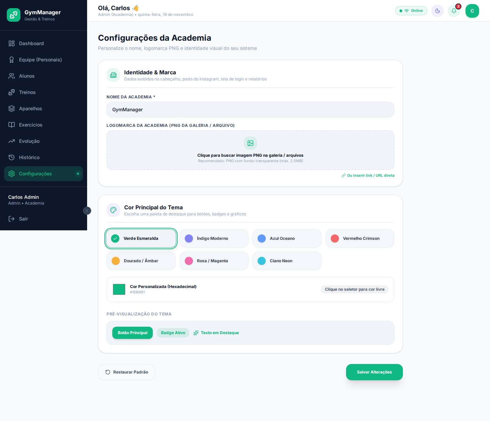

### 9. Alternância para Modo Escuro (`/dashboard`)
Pelo botão de tema no cabeçalho, qualquer usuário pode alternar entre os modos claro e escuro com persistência em `localStorage`, adaptando fundos, superfícies, bordas e contrastes.

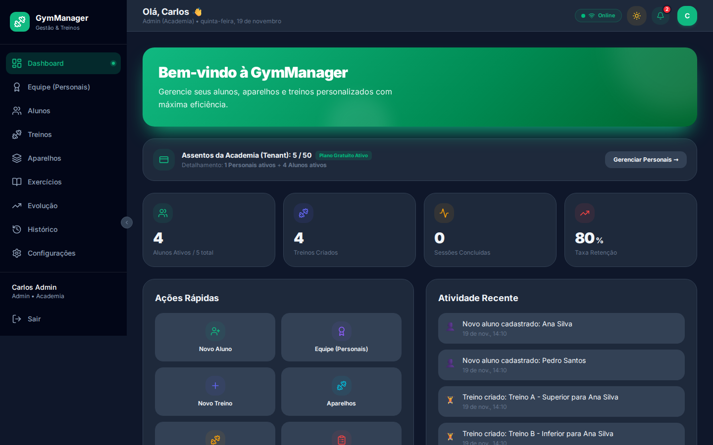

---

## 🏋️ Jornada 3 — Personal Trainer

**Perfil:** `personal@gym.com` / `personal123`  
**Objetivo:** Gerenciar alunos, montar e prescrever treinos, cadastrar aparelhos e exercícios personalizados, registrar avaliações físicas e auditar a evolução e o histórico da academia (sem acesso às rotas administrativas `/personais` e `/configuracoes`).

### 1. Dashboard Operacional do Personal (`/dashboard`)
A barra lateral exibe apenas as funcionalidades operacionais do Personal (`Dashboard`, `Alunos`, `Treinos`, `Aparelhos`, `Exercícios`, `Evolução` e `Histórico`), mantendo o foco na prescrição e acompanhamento dos alunos.

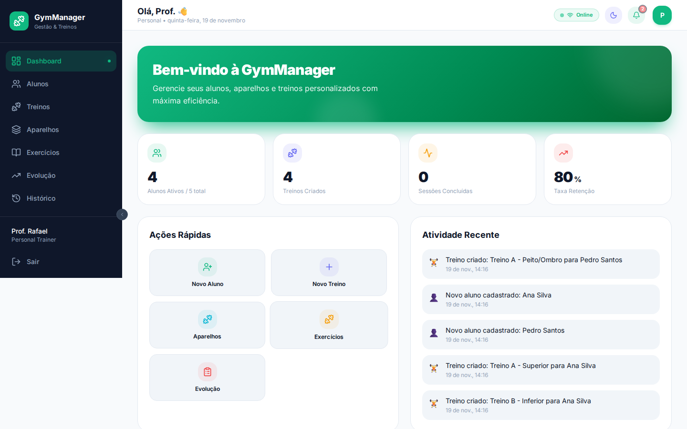

### 2. Criação de Treino com Seleção de Exercícios (`/treinos`)
No modal **Novo Treino**, o Personal define o nome da ficha, vincula a um aluno específico (ou deixa como *Biblioteca da Academia / Comunidade*), informa grupo muscular e observações, e pesquisa exercícios no catálogo para configurar séries, repetições e carga.

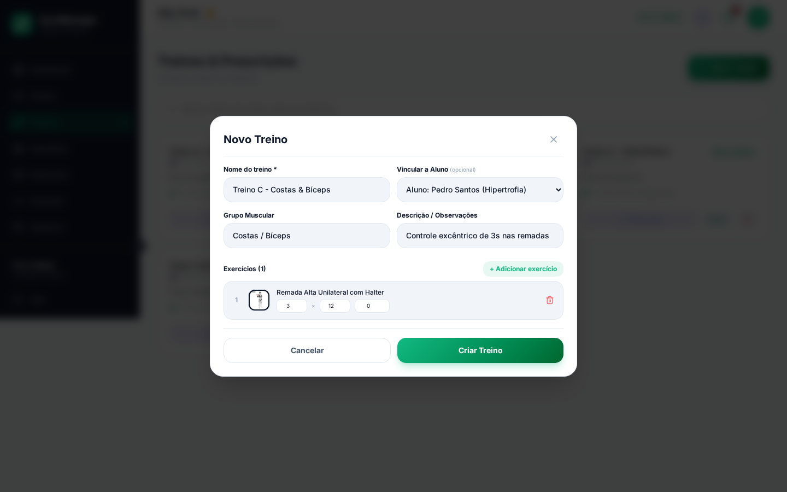

### 3. Prescrição em Lote para Múltiplos Alunos
Ao clicar em **Prescrever** em qualquer card de treino, o modal **Prescrever Treino** permite buscar alunos ativos, selecionar um ou vários destinatários (ou usar *Selecionar Todos*) e clonar a ficha automaticamente para cada aluno selecionado.

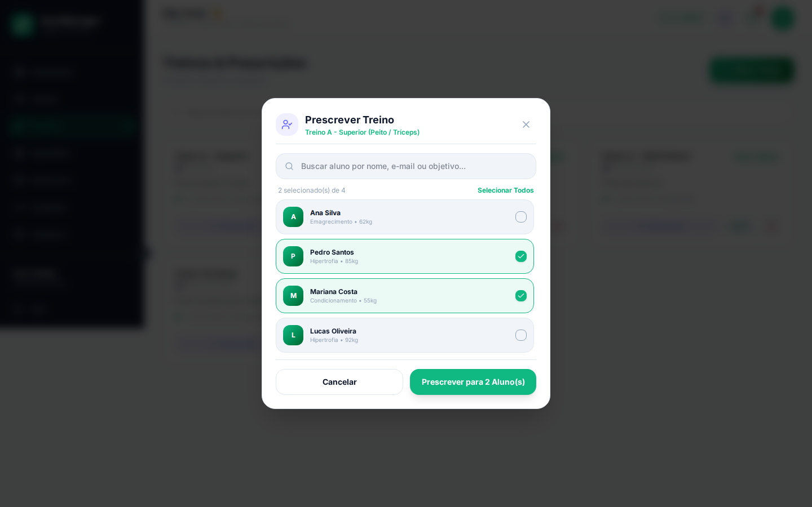

### 4. Catálogo de Exercícios e Filtros Combinados (`/exercicios`)
O catálogo reúne 556 exercícios do repositório base com GIFs demonstrativos, barra de pesquisa e painel expansível de filtros por **Grupo Muscular** e **Equipamento**.

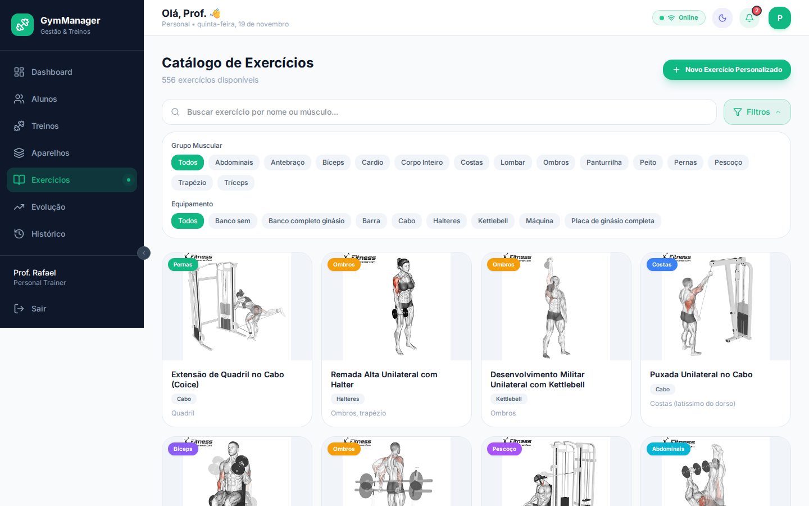

### 5. Cadastro de Exercício Personalizado
Clicando em **Novo Exercício Personalizado**, o Personal (ou Admin) adiciona movimentos exclusivos da academia, escolhendo grupo muscular, equipamento, músculos trabalhados, instruções e URL opcional de imagem/GIF.

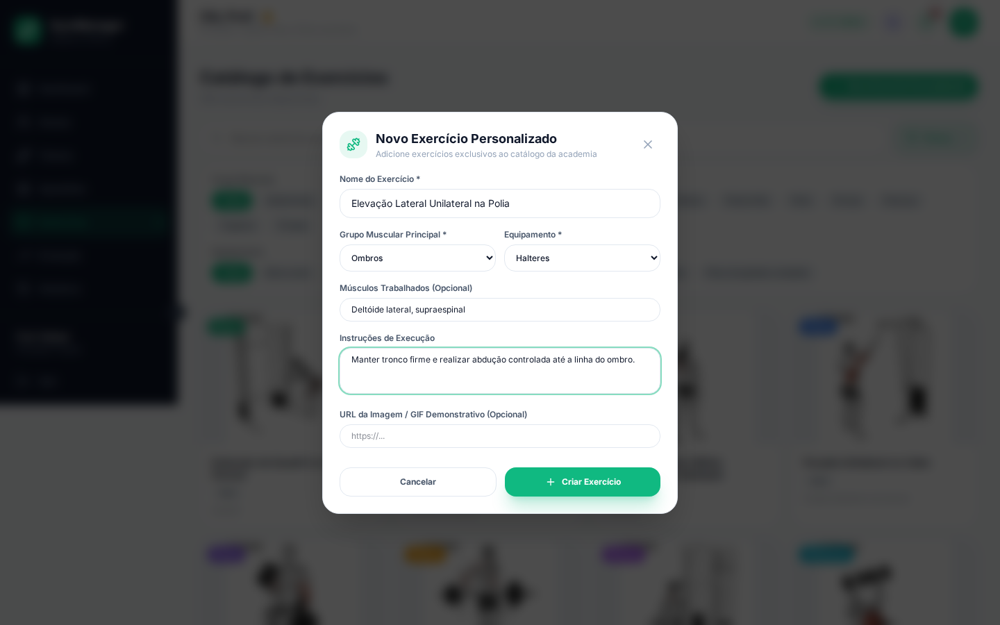

### 6. Acompanhamento de Evolução Física (`/evolucao`)
O Personal seleciona qualquer aluno no topo da tela para visualizar os cards de **Peso Atual**, **IMC**, **% Gordura** e **Massa Muscular**, o gráfico temporal interativo (*Chart.js*) e a tabela histórica de medições com opção de registrar novas avaliações.

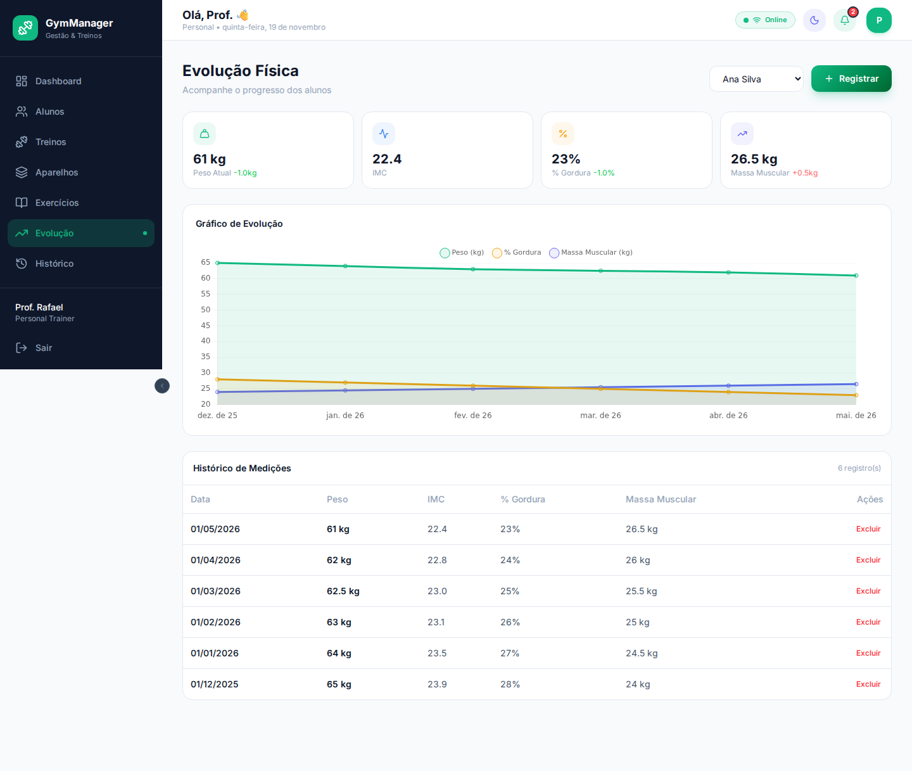

### 7. Cadastro de Aparelho (`/aparelhos`)
O Personal também pode cadastrar novos aparelhos informando nome, marca, modelo, localização livre na academia, status e observações de manutenção/capacidade.

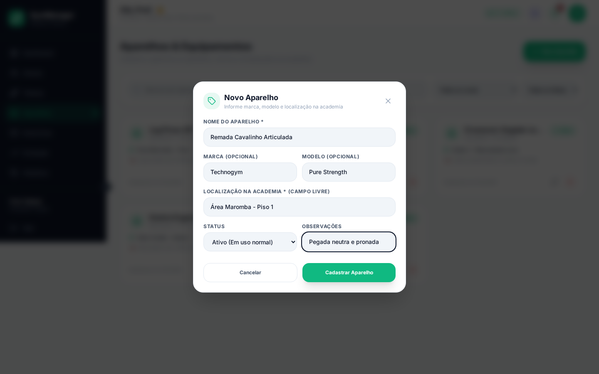

### 8. Histórico e Auditoria (`/historico`)
Na tela **Histórico & Auditoria**, o Personal consulta as abas **Treinos Realizados** e **Log de Atividades**, podendo filtrar por termo ou selecionar um aluno específico para auditar cadastros, prescrições e registros.

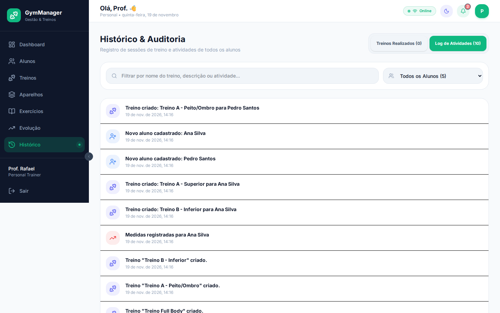

---

## 🏃 Jornada 4 — Aluno (Desktop & Mobile PWA)

**Perfil:** `aluno@gym.com` / `aluno123` (`Ana Silva`)  
**Objetivo:** Consultar fichas prescritas e treinos da comunidade, executar treinos em tempo real com cronômetro e descanso guiado, compartilhar conquistas em formato Story, acompanhar evolução corporal e utilizar a experiência responsiva no smartphone.

### 1. Dashboard do Aluno (`/dashboard`)
Destaca o cartão de boas-vindas com o botão **Iniciar Treino de Hoje**, métricas pessoais (*Treinos Concluídos*, *Dias Seguidos*, *Volume Levantado* e *Peso Atual*), ações rápidas e últimas atividades relacionadas ao aluno.

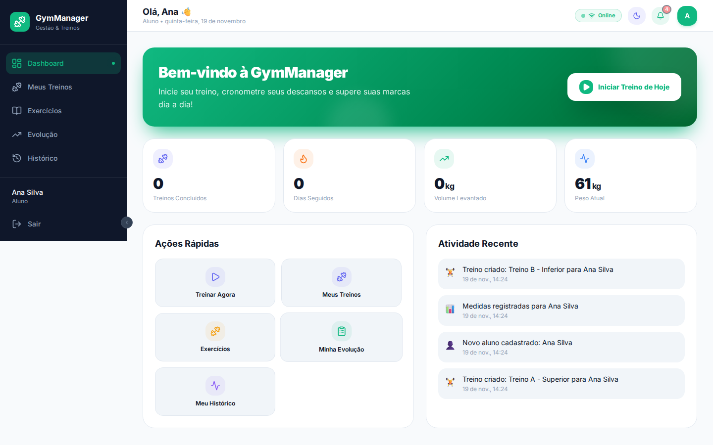

### 2. Meus Treinos & Treinos da Comunidade (`/meus-treinos`)
Reúne o banner de acesso rápido ao treino principal, as abas **Meus Treinos** e **Comunidade** (onde o aluno pode copiar treinos da academia para sua ficha) e o botão **Criar Meu Treino**.

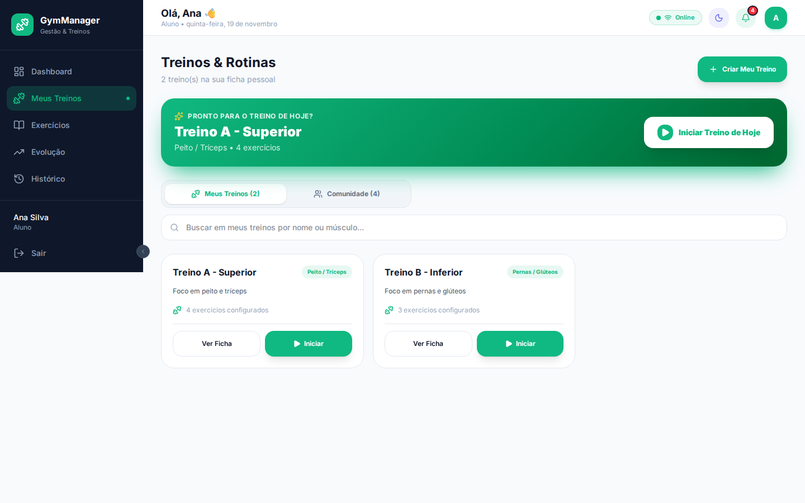

### 3. Visualização Detalhada da Ficha e Impressão PDF
Ao clicar em **Ver Ficha**, o modal lista cada exercício com imagem/GIF de apoio, séries, repetições, carga prevista e observações, oferecendo os botões **Imprimir Ficha (PDF)** e **Iniciar Treino**.

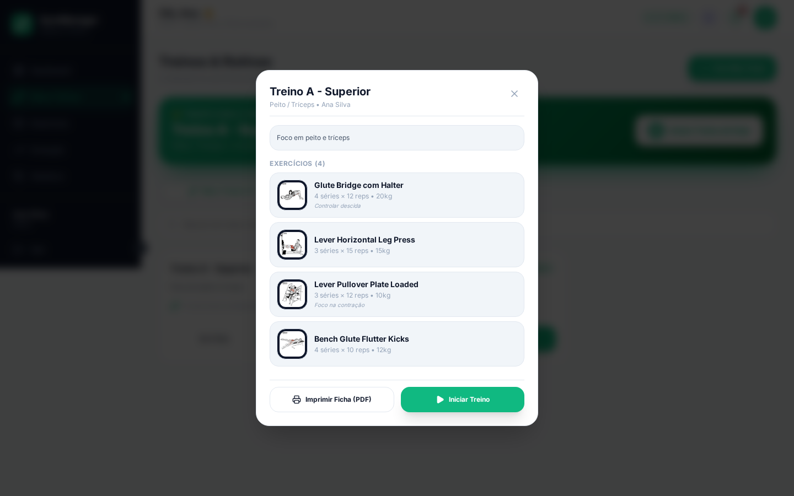

### 4. Execução de Treino em Tempo Real (`/treino-ativo/:workoutId`)
Durante o treino ativo, o cabeçalho fixo mantém o **cronômetro ao vivo** (com pausa/retomada) e o botão **Finalizar Treino**. A barra de progresso e o **Volume Total (kg)** atualizam em tempo real à medida que as séries são marcadas, disparando automaticamente o overlay flutuante **Tempo de Descanso** (com ajustes `-15s` / `+15s`, silenciamento sonoro e botão *Pular*).

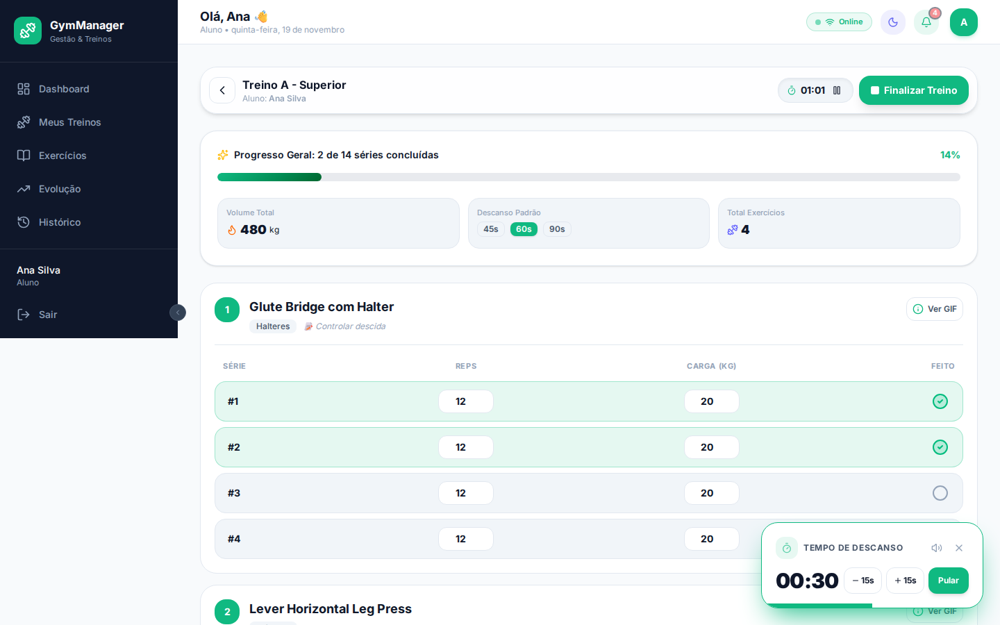

### 5. Resumo e Finalização do Treino
Ao clicar em **Finalizar Treino**, o modal exibe duração total, séries concluídas e volume levantado, permite registrar observações da sessão, gerar post social ou confirmar e salvar no histórico.

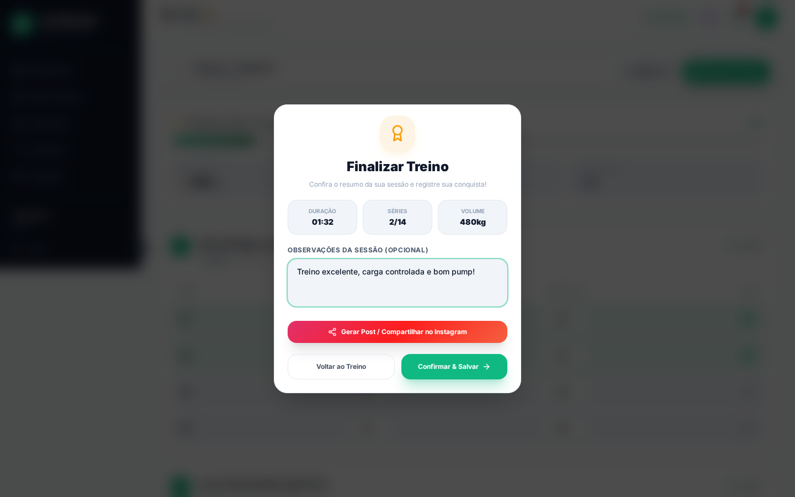

### 6. Gerador de Post para Instagram Stories
Clicando em **Gerar Post / Compartilhar no Instagram**, o aluno personaliza o card vertical `9:16` em canvas (escolhendo paleta visual, frase motivacional, emojis, hashtags e métricas exibidas) para baixar na galeria, copiar legenda ou compartilhar nos Stories.

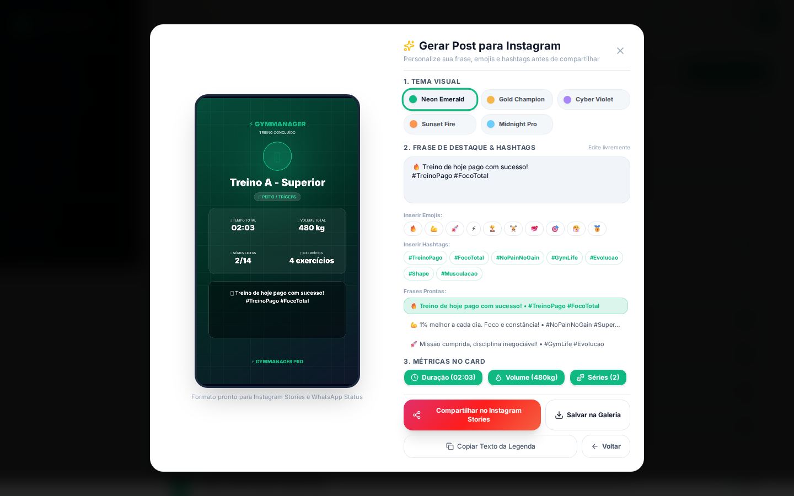

### 7. Meu Histórico de Sessões (`/historico`)
Após confirmar e salvar o treino, a sessão concluída passa a constar imediatamente na aba **Treinos Realizados** com duração, volume total (`480 kg`), séries concluídas (`2/14`) e acesso aos detalhes completos.

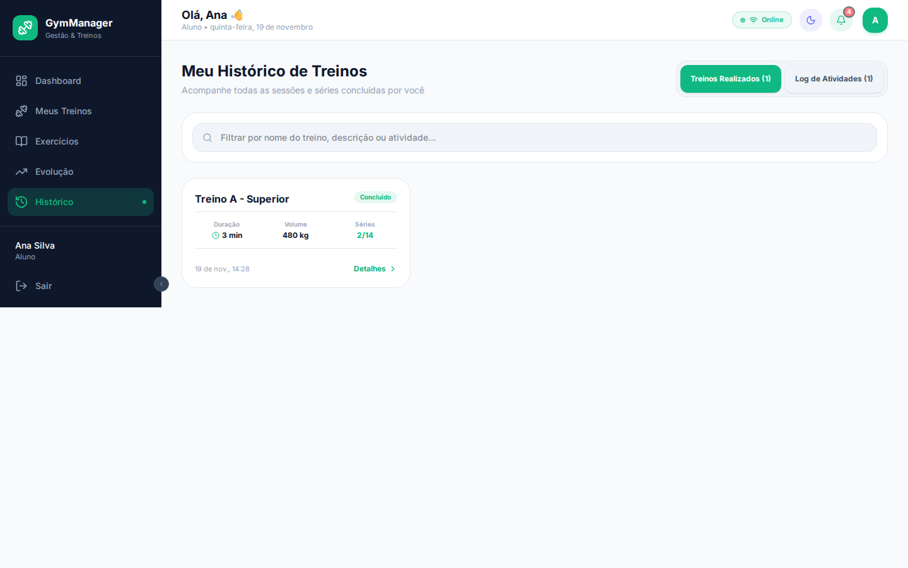

### 8. Minha Evolução Física (`/evolucao`)
O aluno acompanha sua própria curva de peso, percentual de gordura e massa muscular ao longo do tempo, além de poder registrar novas medições pelo botão **Registrar Minha Evolução**.

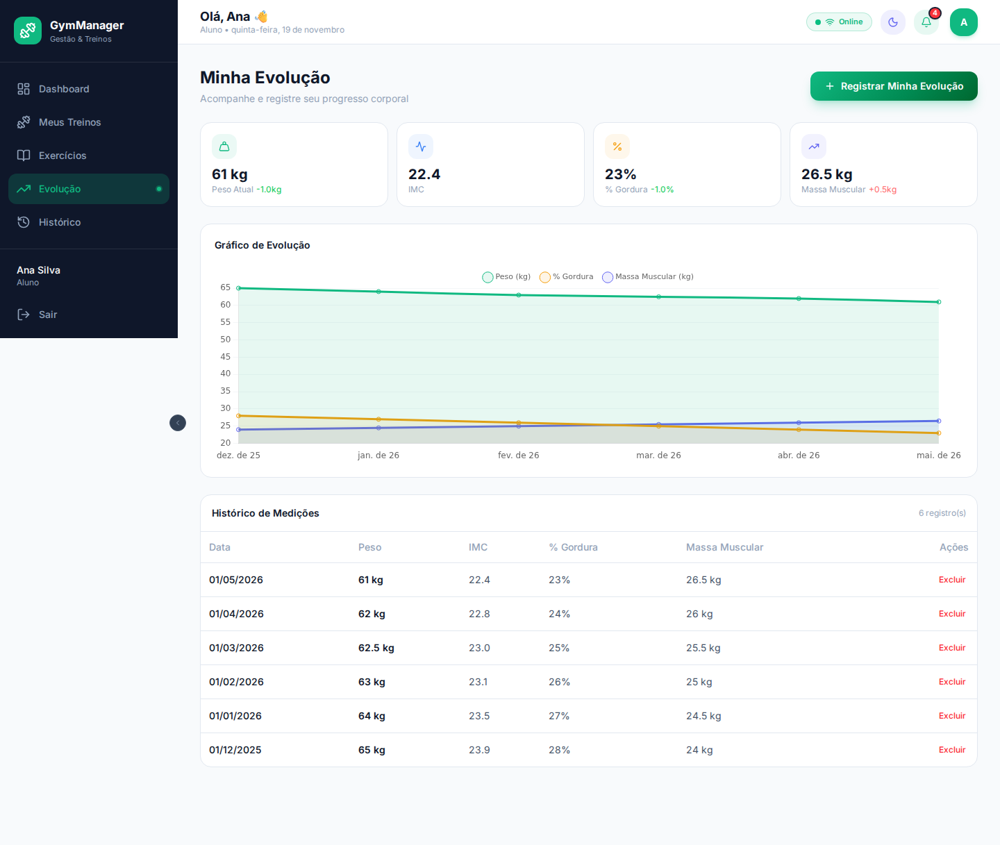

### 9. Detalhe de Exercício no Catálogo (`/exercicios`)
No catálogo de exercícios, o aluno pode abrir qualquer movimento para visualizar o GIF ampliado, músculos trabalhados, equipamento e instruções de execução.

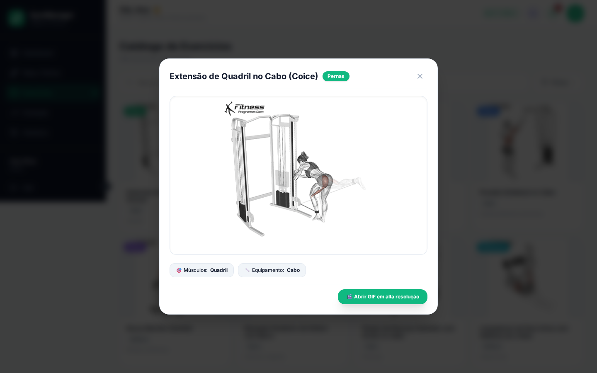

### 10. Meu Perfil & Galeria de Avatares Fitness
Pelo menu do usuário no cabeçalho (**Meu Perfil & Avatar**), o aluno atualiza seus dados pessoais/corporais e escolhe um avatar fitness estilizado ou envia foto própria.

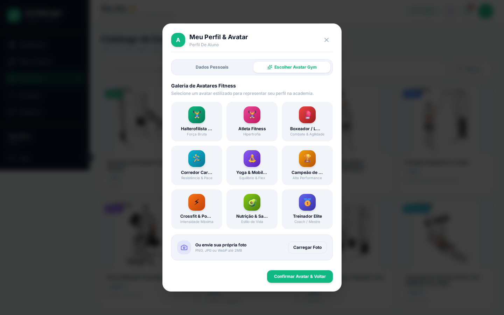

### 11. Experiência Mobile PWA — Dashboard (`390x844`)
Em telas de smartphone, a barra lateral dá lugar à navegação inferior fixa (`MobileNav` com *Home*, *Treinos*, *Exercícios*, *Evolução* e *Histórico*), mantendo o CTA **Iniciar Treino de Hoje** em destaque.

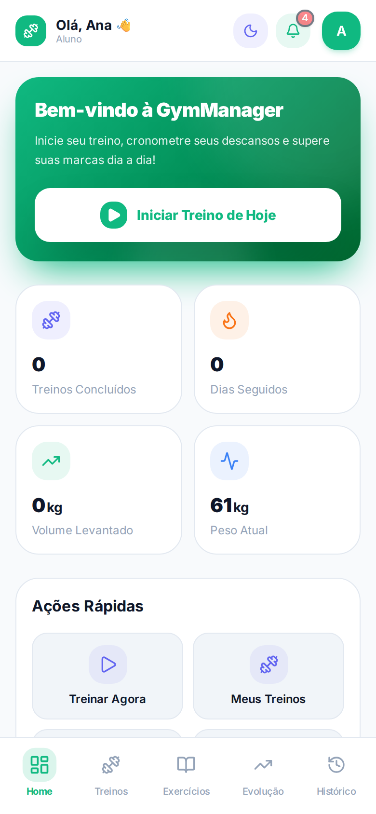

### 12. Experiência Mobile PWA — Treino Ativo com Timer de Descanso
Na execução mobile, o cabeçalho compacto mantém cronômetro e botão **Finalizar**, enquanto o overlay de descanso posiciona-se acima da barra de navegação inferior sem sobrepor os botões de rota.

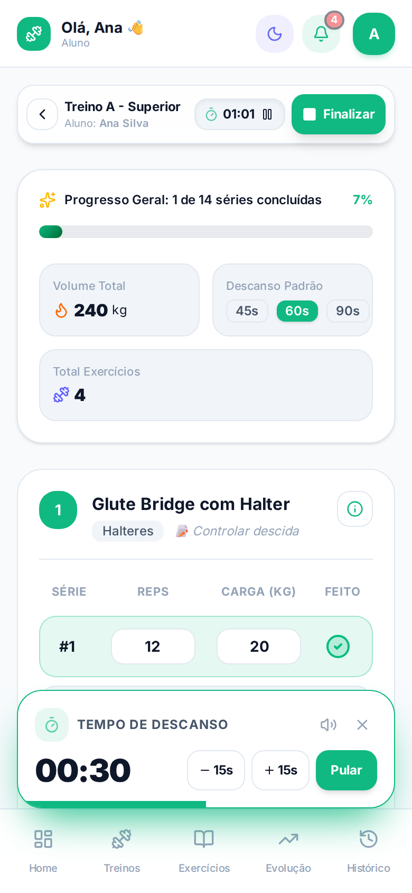

---

## 🛠️ Como Reproduzir ou Atualizar os Prints Localmente

O script automatizado em [`scripts/capture-user-journeys.mjs`](../scripts/capture-user-journeys.mjs) gera o build de produção (para evitar duplicação de seed pelo `React.StrictMode` em desenvolvimento), sobe um servidor `vite preview` temporário na porta `5175`, navega por todas as jornadas acima em contextos isolados e encerra o servidor automaticamente ao finalizar.

### Pré-requisitos
- Node.js ≥ 18 e dependências do projeto instaladas (`npm install`)
- `playwright` ou `playwright-core` instalado no projeto, globalmente ou acessível via `PLAYWRIGHT_MODULE_PATH`, além do binário Chromium do Playwright (`npx playwright install chromium`)

### Execução no WSL / Linux

```bash
# Gerar/atualizar as capturas de tela (Desktop + Mobile):
node scripts/capture-user-journeys.mjs

# Gerar/atualizar o vídeo de demonstração no formato mobile (390x844):
node scripts/record-mobile-demo.mjs

# Ou informando um caminho específico para playwright-core (sem alterar o package.json):
PLAYWRIGHT_MODULE_PATH=/caminho/para/node_modules/playwright-core node scripts/capture-user-journeys.mjs
PLAYWRIGHT_MODULE_PATH=/caminho/para/node_modules/playwright-core node scripts/record-mobile-demo.mjs
```

### Variáveis de Ambiente Opcionais

| Variável | Descrição |
|---|---|
| `PLAYWRIGHT_MODULE_PATH` | Caminho explícito para o módulo `playwright` ou `playwright-core` |
| `APP_URL` | URL de uma instância já em execução (ex.: `http://127.0.0.1:4173`), pulando o start automático do `vite preview` |
| `SKIP_BUILD=1` | Reutiliza o diretório `dist/` existente sem rodar `npm run build` novamente |
